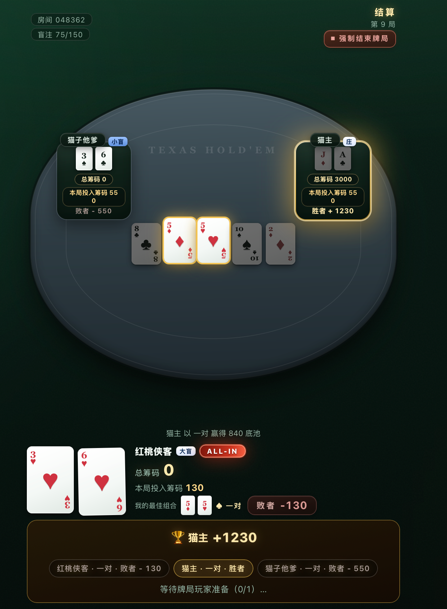
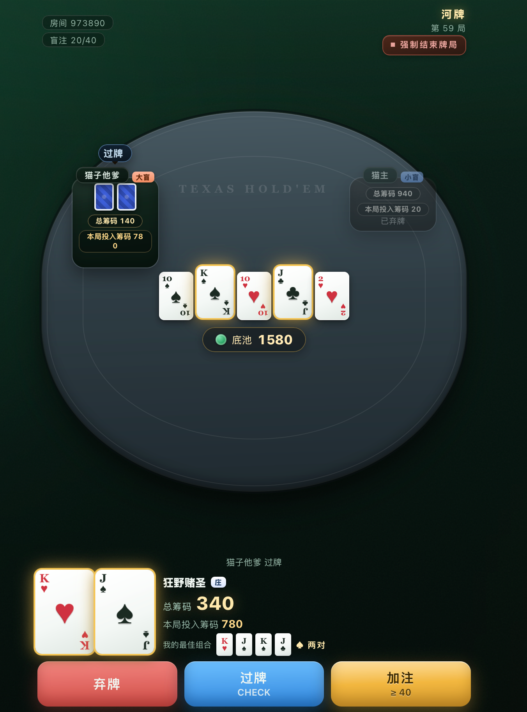
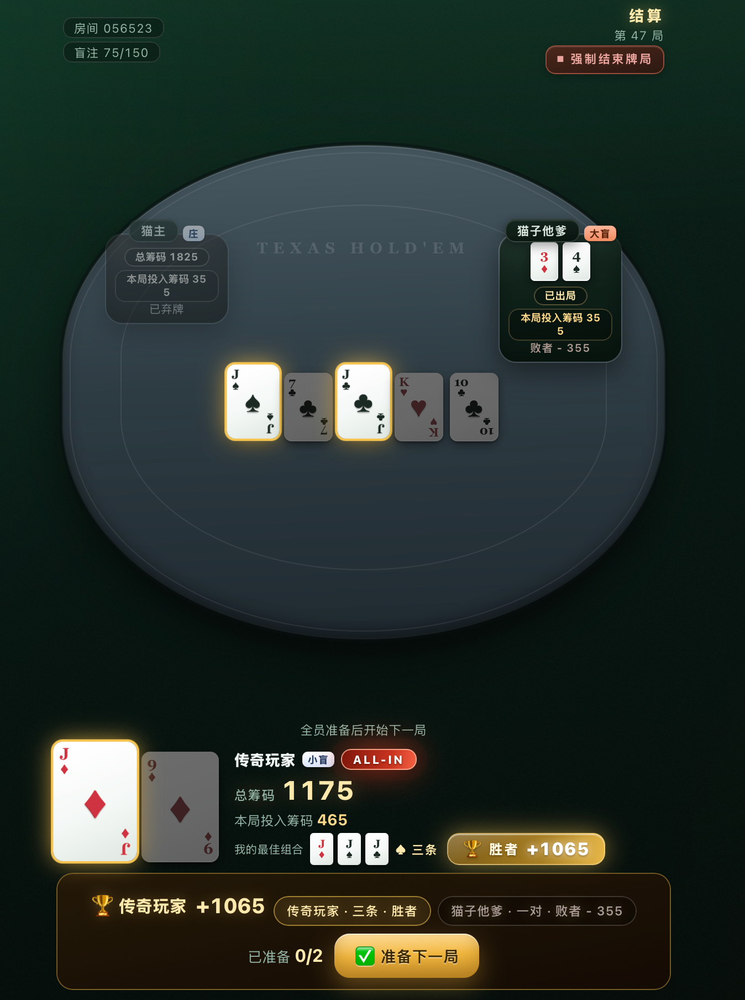
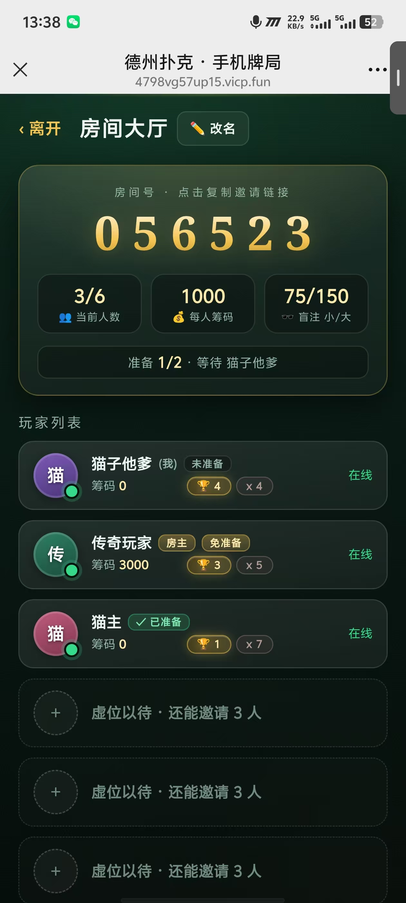
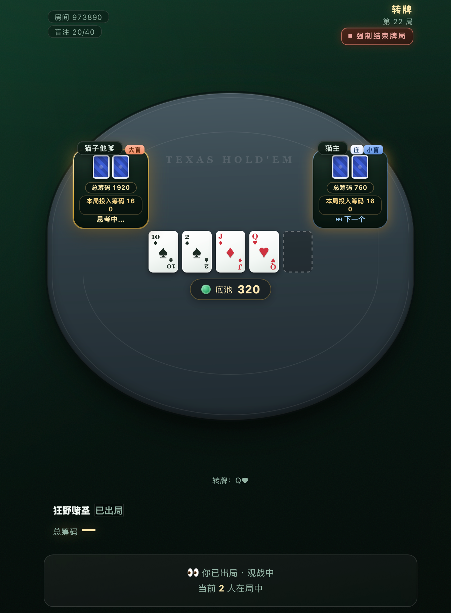
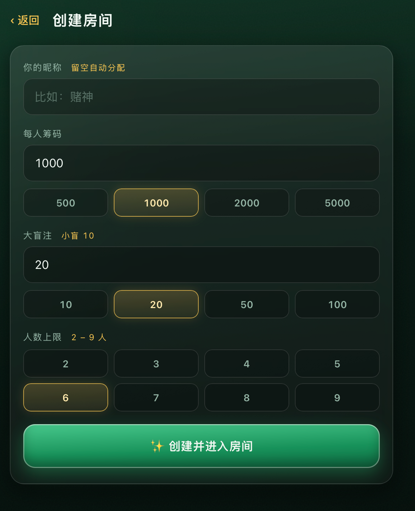

# 🃏 德州扑克 · 联机 Web 版

德州扑克多人联机游戏。朋友各自用手机或电脑浏览器输入房间号即可加入同一牌局，实时对战。

> 纯 Node.js + Socket.IO 实时通信 · 原生前端零构建 · 移动端优先设计 · 所有牌局逻辑在服务端（防作弊）

## 🏗️ 示例演示













## ✨ 功能一览

### 房间管理
- **创建房间**：自定义每人筹码（100 ~ 100 万）、大盲注（小盲自动减半），生成 6 位数字房间号
- **邀请链接**：点击房间号一键复制邀请链接（`?r=房间号` 格式，兼容内网穿透），朋友浏览器打开直达加入；老玩家自动恢复座位回对局
- **昵称留空自动分配**：不填昵称自动生成牌手风昵称（如「梭哈老手」「孤注骑士」），最多 5 个字
- **加入房间**：输入房间号 + 昵称即可入座；断线后重新打开页面/邀请链接自动恢复座位与筹码
- **实时人数**：房间大厅实时显示 `当前人数 / 上限`、在线状态
- **准备制开局**：大厅房客全员准备 + 房主点开始；局间全员（含房主、含离线者）准备后自动开下一局
- **房主管理**：踢人、修改房间配置（筹码/盲注）、强制结束牌局（三选一弹窗：取消 / 不计积分 / 计入积分）
- **积分排行**：按出局顺序积分（第1出局+1、第2出局+2…冠军=人数分），同轮/同筹码并列取最小分；大厅按总分降序排列

### 完整牌局
- **标准规则**：按钮轮转、小盲/大盲（中文徽章庄/小盲/大盲）、四条街下注（弃牌/过牌/跟注/加注/全下）、最小加注校验、边池分层、摊牌比牌（中文牌型名）、平分底池、未被跟注退回
- **行动顺序**：当前行动者金环「思考中」+ 下一行动者蓝标「⏭ 下一个」
- **不限时**：无行动倒计时，掉线不代打、不弃牌，牌局等待玩家回归（离线者也占准备名额）
- **加注输入**：滑块 + 手动输入数字双向联动 + 快捷键（最小 / ½池 / 满池 / 全下），越界自动纠正
- **投入透明**：每人实时显示「总筹码」与「本局投入筹码」（跨街累计）
- **实时组合**：翻牌后自动计算并高亮你的最强组合（无组合显示最强单张）+ 牌型标签
- **全下盛宴**：全员 ALL IN 先亮底牌 + 实时胜率指示器（精确枚举/蒙特卡洛，河牌后 100%/0%）+ 慢翻公牌逐街揭晓
- **摊牌复盘**：终局保留公共牌与各家亮牌，只高亮胜者组合（高牌亮最大单张），胜负徽章（胜者 +N / 败者 -N，含未跟注退回净额）
- **主动亮牌**：局末任何玩家（含弃牌者）可把底牌亮给全桌看
- **冠军与出局**：筹码打空出局观战，最后一人夺冠；终局横幅 + 底部「返回房间」（单人行为，各自独立）重组再战

## 🚀 快速开始

> **30 秒极简启动**：`npm install && npm start` → 手机连同一 Wi-Fi 打开控制台打印的局域网地址。

## 编译与启动

本项目**无需编译**——前端是原生 HTML/CSS/JS（无构建步骤），后端是纯 Node.js，`npm install` 装完依赖即可直接运行（支持 Docker 部署）。

### 环境要求

| 依赖 | 版本 | 检查命令 |
|---|---|---|
| Node.js | ≥ 16（推荐 18+） | `node -v` |
| npm | ≥ 8（随 Node 附带） | `npm -v` |

> macOS 可用 `brew install node` 安装；Windows 去 [nodejs.org](https://nodejs.org) 下载 LTS 安装包。

### 安装依赖

```bash
npm install        # 只有两个依赖：express + socket.io，几秒装完
```

### 启动

```bash
npm start          # 等价于 node server.js，默认监听 18888 端口
```

自定义端口（比如 8080）：

```bash
PORT=8080 npm start            # macOS / Linux
# Windows PowerShell:
$env:PORT=8080; npm start
```

后台常驻运行（macOS / Linux，日志写入 poker.log）：

```bash
nohup npm start > poker.log 2>&1 &
tail -f poker.log             # 实时看日志
```

启动成功后控制台会打印：

```
🃏 德州扑克服务器已启动
   本机访问:   http://localhost:18888
   局域网访问: http://192.168.x.x:18888  （手机连同一 Wi-Fi 打开此地址）
```

### 停止服务

```bash
# 前台运行：直接 Ctrl + C
# 后台运行：
pkill -f "node server.js"
```

### 手机访问（同局域网）

1. 启动后记下控制台打印的**局域网地址**（如 `http://192.168.124.8:18888`）
2. 手机连接与电脑**同一个 Wi-Fi**，浏览器打开该地址即可
3. 房主创建房间 → 把邀请链接/房间号发给朋友 → 朋友点开即入

> 本机想开多个玩家测试：用 `http://localhost:18888`、`http://localhost:18888/?u=b`、`http://localhost:18888/?u=c` 区分各自的会话。

### Docker 启动（可选）

```bash
docker compose up -d --build     # 构建并后台启动
docker compose logs -f           # 看日志
docker compose down              # 停止
```

- 访问地址不变：本机 `http://localhost:18888`，局域网 `http://<主机IP>:18888`
- 房间状态在进程内存中：**重启容器会清空所有房间**（等同服务器重启）
- 自定义端口：修改 `docker-compose.yml` 中 `ports` 的左侧端口（如 `"8080:18888"`）

### 常见问题

| 现象 | 解决 |
|---|---|
| `EADDRINUSE: port 18888 in use` | 端口被占用：`pkill -f "node server.js"` 杀掉旧进程，或换 `PORT=8080 npm start` |
| 手机打不开局域网地址 | 确认手机与电脑同一 Wi-Fi；macOS 在「系统设置 → 网络 → Wi-Fi → 详细信息」里开启局域网共享/允许传入连接 |
| 改版后手机没变化 | 静态资源已设 `no-cache`，普通刷新即可；个别内置浏览器需彻底关闭页面重开 |
| 页面开着但提示「连接已断开」 | 服务被停止了，重启 `npm start` 后**刷新页面**会自动恢复座位 |
| `command not found: node` | 未安装 Node.js，见上方环境要求 |

## 🎮 玩法

1. 一人 **创建房间**（设置筹码 / 盲注），点房间号复制邀请链接发给朋友
2. 其余人 **打开链接加入**（或输房间号 + 昵称，昵称留空自动分配），房客点准备
3. 房主点 **开始游戏**，每人发两张底牌（自己的牌只有自己可见）
4. 轮到自己时底部出现操作栏：弃牌 / 过牌 / 跟注 / 加注（滑块或输入数字 + 快捷键）
5. 全员 ALL IN 会先亮底牌并显示实时胜率，逐街慢翻公牌
6. 摊牌自动比牌结算（胜者组合高亮、胜负徽章、本局牌面保留可复盘），全员准备后开下一局
7. 筹码打空自动出局观战，最后一人夺冠；终局可点「返回房间」各自重组（开新场恢复初始筹码）

## 🏆 积分规则

| 出局顺序 | 得分 |
|---|---|
| 第 1 个出局 | +1 |
| 第 2 个出局 | +2 |
| … | … |
| 冠军 | +人数分 |

- **同轮并列**：同一局被淘汰的玩家取该轮**最小顺序位**的积分（如 B、C 同为第 2-3 位 → 各 +2）
- **强结计分**：按当前筹码（含底池）排名，同筹码并列同样往下取
- 积分跨场**累加**，大厅按总分降序排列

## 🏗️ 技术架构

```
├── server.js            # 入口：Express 静态托管 + Socket.IO 事件路由
├── src/                 # 后端（所有牌局逻辑在服务端，防作弊）
│   ├── room.js          #   房间管理：创建/加入/踢人/断线恢复/积分/空房清理
│   ├── game.js          #   牌局引擎：下注轮状态机、边池分层、胜率计算、摊牌结算
│   ├── evaluator.js     #   5~7 张牌型评估、比较与关键牌提取（高亮用）
│   └── cards.js         #   洗牌发牌
├── public/              # 前端（原生 HTML/CSS/JS，无构建步骤，移动端优先）
│   ├── index.html       #   大厅/创建/加入/房间/牌桌五个视图
│   ├── css/style.css    #   深夜赌场视觉系统（含 iOS 矮屏适配）
│   └── js/
│       ├── evaluator.js #   前端牌型评估（实时组合与胜率展示）
│       ├── net.js       #   Socket.IO 封装
│       ├── lobby.js     #   大厅/房间视图（准备/踢人/设置/邀请链接）
│       ├── table.js     #   牌桌渲染（座位/公共牌/操作栏/结算）
│       └── main.js      #   视图路由与会话恢复
├── Dockerfile           # Docker 镜像（node:20-alpine + 健康检查）
├── docker-compose.yml   # 一键容器化启动
└── test/logic.test.js   # 逻辑自测（无框架，node 直接跑）
```
